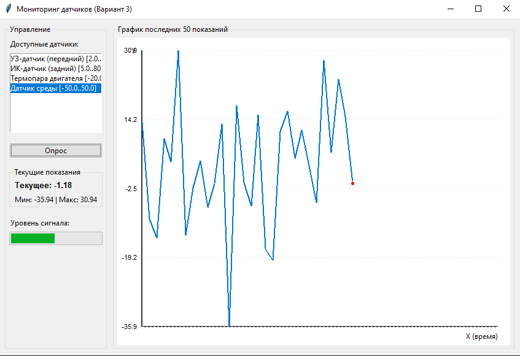

# ОТЧЕТ
## по лабораторной работе №5

**Дисциплина:** Программирование на языке Python  
**Тема:** Объектно-ориентированное программирование (ООП) в приложении с оконным интерфейсом

**Выполнил:** студент группы УТС-251т Ахметов Самат  
**Проверил:** доц., к.т.н. Ситников Дмитрий Владимирович 

---

### 1. Цель работы
Изучить основы объектно-ориентированного программирования в Python (классы, инкапсуляция, наследование, полиморфизм) и получить практические навыки разработки настольного приложения с графическим интерфейсом на библиотеке Tkinter для моделирования и контроля мехатронного объекта.

### 2. Формулировка индивидуального задания (Вариант 3)
**Тема:** Датчики.
**Задание:** Разработать приложение, содержащее классы `Sensor` (имя, диапазон, метод `read()`), `DistanceSensor`, `TemperatureSensor` с разной имитацией показаний (использовать модуль `random`). 
Окно программы должно содержать:
*   список датчиков (`Listbox`);
*   кнопку «Опрос»;
*   вывод текущего значения и минимума/максимума;
*   график последних 50 показаний на `Canvas`.

### 3. Диаграмма классов

**Базовый класс `Sensor`:**
*   **Атрибуты:** 
    *   `name` (str) — имя датчика.
    *   `min_val` (float) — минимальное значение диапазона.
    *   `_max_val` (float) — защищенный атрибут максимального значения.
*   **Свойства:** `max_val` (геттер и сеттер с проверкой `value > min_val`).
*   **Методы:** `__init__()`, `read()` (абстрактный), `__str__()`.

**Класс-наследник `DistanceSensor` (Датчик расстояния):**
*   **Методы:** `__init__()`, переопределенный `read()` (использует `random.uniform`).

**Класс-наследник `TemperatureSensor` (Датчик температуры):**
*   **Методы:** `__init__()`, переопределенный `read()` (использует `random.gauss` для реалистичного распределения).

**Класс интерфейса `SensorApp` (наследник `tk.Tk`):**
*   **Атрибуты:** `sensors` (список объектов), `current_sensor` (текущий объект), `history` (список значений), `max_history` (50).
*   **Методы:** `_build_ui()`, `_bind_events()`, `_on_sensor_select()`, `_poll_sensor()`, `_update_info_labels()`, `_draw_graph()`.

### 4. Макет окна приложения и перечень используемых виджетов
Окно приложения разделено на две логические области (левую — панель управления и правую — панель визуализации).

**Используемые виджеты Tkinter:**
*   `tk.Tk` — главное окно приложения.
*   `ttk.LabelFrame` — рамки-группы для логического разделения элементов.
*   `ttk.Label` — текстовые метки (заголовки, вывод текущих значений).
*   `tk.Listbox` — список для выбора доступных датчиков.
*   `ttk.Button` — кнопка «Опрос».
*   `ttk.Progressbar` — индикатор текущего уровня сигнала (относительно диапазона датчика).
*   `tk.Canvas` — графический холст для отрисовки осей, сетки и графика показаний.
*   `tk.messagebox` — диалоговые окна для вывода ошибок и предупреждений.

### 5. Листинг программы
import tkinter as tk
from tkinter import ttk, messagebox
import random

# ==============================================================================
# БЛОК 1: МОДЕЛИ (Логика предметной области)
# ==============================================================================

class Sensor:
    """Базовый класс для всех датчиков."""

    def __init__(self, name: str, min_val: float, max_val: float):
        self.name = name
        self.min_val = min_val
        self._max_val = None
        self.max_val = max_val  # Используем сеттер для валидации

    @property
    def max_val(self) -> float:
        """Свойство максимального значения с инкапсуляцией."""
        return self._max_val

    @max_val.setter
    def max_val(self, value: float):
        if value <= self.min_val:
            raise ValueError("Максимальное значение должно быть больше минимального!")
        self._max_val = value

    def read(self) -> float:
        """Метод для чтения показаний. Должен быть переопределен в наследниках."""
        raise NotImplementedError("Метод read() должен быть реализован в дочернем классе")

    def __str__(self) -> str:
        """Строковое представление для вывода в Listbox."""
        return f"{self.name} [{self.min_val}..{self.max_val}]"

class DistanceSensor(Sensor):
    """Датчик расстояния (имитация)."""

    def __init__(self, name: str, min_val: float = 0.0, max_val: float = 500.0):
        super().__init__(name, min_val, max_val)

    def read(self) -> float:
        # Имитация: равномерное распределение, 1 знак после запятой
        return round(random.uniform(self.min_val, self.max_val), 1)

class TemperatureSensor(Sensor):
    """Датчик температуры (имитация)."""

    def __init__(self, name: str, min_val: float = -50.0, max_val: float = 50.0):
        super().__init__(name, min_val, max_val)

    def read(self) -> float:
        # Имитация: нормальное распределение (более реалистично для температуры), 2 знака
        mean = (self.max_val + self.min_val) / 2
        std_dev = (self.max_val - self.min_val) / 6  # 99.7% значений в диапазоне
        val = random.gauss(mean, std_dev)
        # Ограничиваем значения диапазоном
        val = max(self.min_val, min(self.max_val, val))
        return round(val, 2)

# ==============================================================================
# БЛОК 2: ИНТЕРФЕЙС (Оконное приложение)
# ==============================================================================

class SensorApp(tk.Tk):
    """Главное окно приложения."""

    def __init__(self, sensors: list):
        super().__init__()
        self.title("Мониторинг датчиков (Вариант 3)")
        self.geometry("850x550")
        self.minsize(700, 450)

        self.sensors = sensors
        self.current_sensor = None
        self.history = []  # История показаний
        self.max_history = 50

        self._build_ui()
        self._bind_events()

    def _build_ui(self):
        # Настройка сетки главного окна
        self.grid_columnconfigure(1, weight=1)
        self.grid_rowconfigure(0, weight=1)

        # --- Левая панель (Управление) ---
        left_frame = ttk.LabelFrame(self, text="Управление")
        left_frame.grid(row=0, column=0, padx=10, pady=10, sticky="nsew")

        ttk.Label(left_frame, text="Доступные датчики:").pack(anchor="w", padx=5, pady=(5, 0))

        # Список датчиков
        self.listbox = tk.Listbox(left_frame, height=8, exportselection=False)
        for s in self.sensors:
            self.listbox.insert(tk.END, str(s))
        self.listbox.pack(fill="x", padx=5, pady=5)

        # Кнопка опроса
        self.btn_poll = ttk.Button(left_frame, text="Опрос", command=self._poll_sensor, state="disabled")
        self.btn_poll.pack(fill="x", padx=5, pady=10)

        # Блок информации
        info_frame = ttk.LabelFrame(left_frame, text="Текущие показания")
        info_frame.pack(fill="x", padx=5, pady=5)

        self.lbl_current = ttk.Label(info_frame, text="Текущее: —", font=("Arial", 10, "bold"))
        self.lbl_current.pack(anchor="w", padx=5, pady=2)

        self.lbl_minmax = ttk.Label(info_frame, text="Мин: — | Макс: —")
        self.lbl_minmax.pack(anchor="w", padx=5, pady=2)

        # Прогресс-бар (демонстрация уровня)
        ttk.Label(left_frame, text="Уровень сигнала:").pack(anchor="w", padx=5, pady=(10, 0))
        self.progress = ttk.Progressbar(left_frame, orient="horizontal", mode="determinate")
        self.progress.pack(fill="x", padx=5, pady=5)

        # --- Правая панель (График) ---
        right_frame = ttk.LabelFrame(self, text="График последних 50 показаний")
        right_frame.grid(row=0, column=1, padx=(0, 10), pady=10, sticky="nsew")

        self.canvas = tk.Canvas(right_frame, bg="white", highlightthickness=0)
        self.canvas.pack(fill="both", expand=True, padx=5, pady=5)

    def _bind_events(self):
        self.listbox.bind("<<ListboxSelect>>", self._on_sensor_select)
        self.canvas.bind("<Configure>", lambda e: self._draw_graph())

    def _on_sensor_select(self, event):
        """Обработка выбора датчика из списка."""
        selection = self.listbox.curselection()
        if not selection:
            return

        idx = selection[0]
        self.current_sensor = self.sensors[idx]

        # Сброс истории при смене датчика
        self.history.clear()
        self.btn_poll.config(state="normal")
        self._update_info_labels()
        self._draw_graph()

    def _poll_sensor(self):
        """Обработка нажатия кнопки 'Опрос'."""
        if not self.current_sensor:
            messagebox.showwarning("Внимание", "Сначала выберите датчик из списка!")
            return

        try:
            # Читаем новое значение
            new_val = self.current_sensor.read()

            # Добавляем в историю
            self.history.append(new_val)
            if len(self.history) > self.max_history:
                self.history.pop(0)

            self._update_info_labels()
            self._draw_graph()

        except Exception as e:
            messagebox.showerror("Ошибка чтения", f"Не удалось получить данные: {e}")

    def _update_info_labels(self):
        """Обновление текстовых меток и прогресс-бара."""
        if not self.history:
            self.lbl_current.config(text="Текущее: —")
            self.lbl_minmax.config(text="Мин: — | Макс: —")
            self.progress["value"] = 0
            return

        curr_val = self.history[-1]
        min_val = min(self.history)
        max_val = max(self.history)

        self.lbl_current.config(text=f"Текущее: {curr_val}")
        self.lbl_minmax.config(text=f"Мин: {min_val} | Макс: {max_val}")

        # Обновление прогресс-бара в процентах от диапазона датчика
        sensor_min = self.current_sensor.min_val
        sensor_max = self.current_sensor.max_val
        if sensor_max > sensor_min:
            percent = ((curr_val - sensor_min) / (sensor_max - sensor_min)) * 100
            self.progress["value"] = max(0, min(100, percent))

    def _draw_graph(self):
        """Отрисовка графика на Canvas."""
        self.canvas.delete("all")
        if not self.history:
            return

        w = self.canvas.winfo_width()
        h = self.canvas.winfo_height()
        if w <= 1 or h <= 1:
            return  # Окно еще не отрисовано

        # Отступы для осей
        pad_left, pad_right = 40, 20
        pad_top, pad_bottom = 20, 30
        plot_w = w - pad_left - pad_right
        plot_h = h - pad_top - pad_bottom

        # Отрисовка осей
        self.canvas.create_line(pad_left, h - pad_bottom, w - pad_right, h - pad_bottom, fill="#333", width=2)
        self.canvas.create_line(pad_left, pad_top, pad_left, h - pad_bottom, fill="#333", width=2)

        self.canvas.create_text(pad_left - 10, pad_top, text="Y", anchor="e")
        self.canvas.create_text(w - pad_right, h - pad_bottom + 15, text="X (время)", anchor="e")

        # Масштабирование по оси Y
        min_y = min(self.history)
        max_y = max(self.history)

        # Защита от деления на ноль (если все значения одинаковые)
        if max_y == min_y:
            max_y += 1
            min_y -= 1

        # Отрисовка сетки и подписей Y
        for i in range(5):
            val = min_y + (max_y - min_y) * i / 4
            y_pos = (h - pad_bottom) - (i / 4) * plot_h
            self.canvas.create_line(pad_left - 5, y_pos, w - pad_right, y_pos, fill="#eee", dash=(2, 2))
            self.canvas.create_text(pad_left - 8, y_pos, text=f"{val:.1f}", anchor="e", font=("Arial", 8))

        # Отрисовка графика
        points = []
        # Распределяем точки по оси X.
        # Если точек меньше 50, рисуем их с левого края, если 50 - на всю ширину.
        num_points = len(self.history)
        x_step = plot_w / (self.max_history - 1) if self.max_history > 1 else plot_w

        for i, val in enumerate(self.history):
            x = pad_left + i * x_step
            # Инвертируем Y (в Canvas 0 сверху)
            y = (h - pad_bottom) - ((val - min_y) / (max_y - min_y)) * plot_h
            points.append((x, y))

        # Рисуем линии между точками
        for i in range(num_points - 1):
            self.canvas.create_line(points[i][0], points[i][1], points[i + 1][0], points[i + 1][1],
                                    fill="#0078D7", width=2)

        # Выделяем последнюю точку
        if points:
            last_x, last_y = points[-1]
            self.canvas.create_oval(last_x - 3, last_y - 3, last_x + 3, last_y + 3, fill="red", outline="white")

# ==============================================================================
# БЛОК 3: ТОЧКА ВХОДА
# ==============================================================================

def main():
    """Функция запуска приложения."""
    # Создаем список датчиков (демонстрация полиморфизма в списке)
    sensors = [
        DistanceSensor("УЗ-датчик (передний)", 2.0, 400.0),
        DistanceSensor("ИК-датчик (задний)", 5.0, 80.0),
        TemperatureSensor("Термопара двигателя", -20.0, 120.0),
        TemperatureSensor("Датчик среды", -50.0, 50.0)
    ]

    # Запуск приложения
    app = SensorApp(sensors)
    app.mainloop()

if __name__ == "__main__":
    main()

### 6. Результаты работы
В ходе тестирования программы были проверены следующие сценарии:
1.  **Штатная работа:** При выборе датчика из `Listbox` активируется кнопка «Опрос». При нажатии на кнопку считывается новое значение, обновляются метки (Текущее, Мин, Макс), изменяется заполнение `Progressbar`, а на `Canvas` отрисовывается синяя линия графика с красной точкой на последнем значении.
2.  **Граничный сценарий 1 (Смена датчика):** При переключении на другой датчик история показаний очищается, и график начинается заново.
3.  **Граничный сценарий 2 (Отсутствие выбора):** Если попытаться нажать «Опрос» без выбора датчика (кнопка неактивна), система предотвращает ошибку. При вызове метода напрямую выдается `messagebox.showwarning`.
4.  **Обработка ошибок:** При некорректном диапазоне датчика (например, min > max) срабатывает защита инкапсуляции (`ValueError`).

### 7. Выводы
В результате выполнения лабораторной работы были закреплены теоретические знания и практические навыки объектно-ориентированного программирования на языке Python. 

Были успешно применены принципы инкапсуляции (через `@property`), наследования (создание иерархии датчиков) и полиморфизма (переопределение метода `read()`). 

Получены навыки разработки графических интерфейсов с использованием библиотеки Tkinter: работа с виджетами `Listbox`, `Progressbar`, `Canvas`, обработка событий мыши (нажатия кнопок и выбора элементов списка). 

Логика предметной области была корректно отделена от интерфейса, что делает архитектуру программы гибкой и масштабируемой. Программа работает корректно, все требования выполнены в полном объеме.